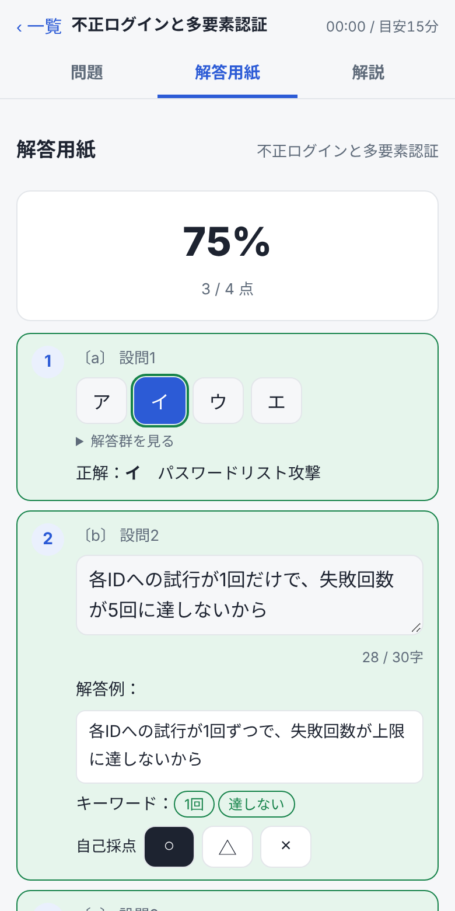
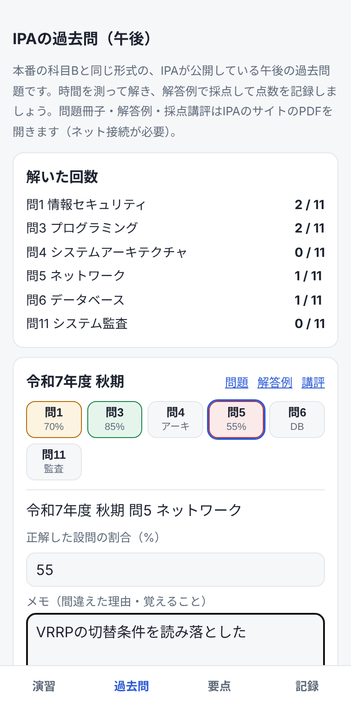
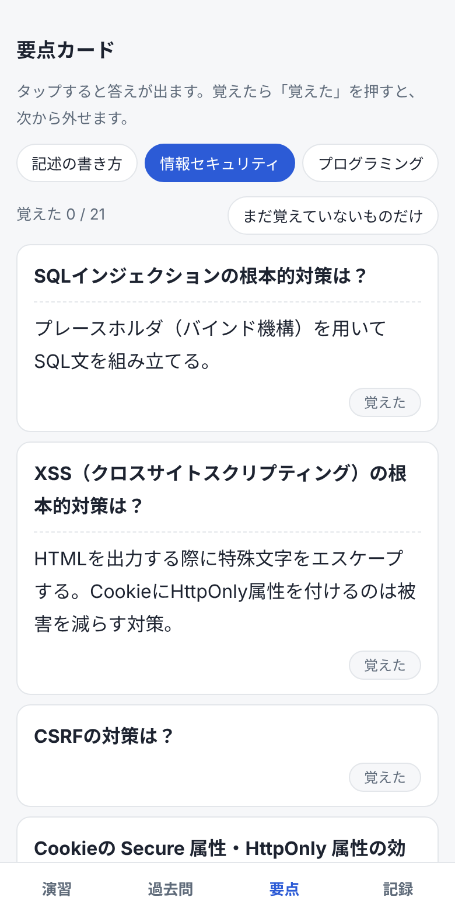

# 応用情報 科目B スマホ演習

[](https://github.com/haru-ki417/ap-b-app/actions/workflows/ci.yml)

**応用情報技術者試験の科目B（旧「午後」）対策を、スマホ1台で。オリジナル問題 43 題（うち本番と同じ長さの「本番レベル」18 題、解答欄 258 個）、IPA の午後過去問 11 回分の記録、要点カード 120 枚、150 分の本番モードをまとめたオフライン対応の Web アプリ（PWA）。**
ホーム画面に追加すればアプリとして起動し、電波のない場所でも使えます。解答と記録はスマホの中だけに保存され、外には送りません。

[**アプリを開く**](https://haru-ki417.github.io/ap-b-app/) — iPhone は Safari の共有ボタン →「ホーム画面に追加」で、アプリとして使えます。

<p>





</p>

左から、演習（本番までの日数と問題の一覧）・問題・採点後の解答用紙・IPA 過去問の記録・要点カード。

> 個人の学習用に作ったアプリです。アプリ内の問題はすべてオリジナルで、IPA（情報処理推進機構）とは関係ありません。過去問タブは IPA が公開している問題冊子・解答例・採点講評へのリンクです（出典：IPA「問題冊子・配点割合・解答例・採点講評」）。

## できること

アプリは「演習」「過去問」「要点」「記録」の 4 つのタブでできています。

| | |
|---|---|
| **演習** | オリジナル問題を解く。科目B と同じ「本文＋設問」の形で、解答群から選ぶ・数値を答える・字数制限つきで記述する、の 3 種類の解答欄がある。本番レベル（1 問 25〜30 分）と短い問題（15〜20 分）があり、「自分の分野」「本番レベル」「分野別」で絞り込める |
| **解答用紙** | 問題文とは別のタブ。どの問題でも同じ形（通し番号・設問・解答欄）。記述欄は字数を数え、上限を超えると赤くなる |
| **採点と解説** | 選択と数値は自動で採点（全角数字や「10回」のような単位つきでも正解になる）。記述は解答例とキーワードを見て ○・△・× を付ける。採点すると、トレース表・計算の途中・記述のコツつきの解説が開く |
| **復習** | ×・△・自己採点待ちの設問がある問題だけを一覧にする |
| **本番モード** | 問1（情報セキュリティ）と、選んだ 4 分野から 1 題ずつ、計 5 題を 150 分で解く。未着手の本番レベルの問題を優先して選び、終わると点数（60 点が合格ライン）と所要時間を記録する |
| **過去問** | IPA が公開している午後の過去問（令和 2〜7 年度の 11 回分）の問題冊子・解答例・採点講評を開ける。問ごとに正解した割合とメモを記録し、分野ごとの解いた回数が分かる |
| **要点カード** | 記述の書き方と、分野ごとの頻出知識（記述でそのまま使える言い回し）。タップで答えが出て、「覚えた」で外せる |
| **記録** | 本番の日（演習タブに残り日数を表示）と本番で選ぶ分野の設定。分野ごとに、演習・過去問の平均と覚えたカードの数を並べ、弱い分野が分かる |
| **オフライン・ダークモード** | 一度開けば機内モードでも使える（過去問の PDF はネット接続が必要）。スマホの設定に合わせてダークモードになる |

## 分野と問題

科目B は 150 分で、問1（情報セキュリティ）が必須、問2〜11 から 4 問を選んで解きます。全 11 分野の問題があり、本番で選ぶ人の多い分野には本番レベルの問題を入れています。

| 分野 | 短い問題 | 本番レベル | 本番レベルの題材 | 要点カード |
|---|---:|---:|---|---:|
| 問1 情報セキュリティ（必須） | 4 | 3 | 標的型攻撃メールによる感染とインシデント対応／クラウドストレージの共有設定とアカウント管理／会員サイトのセッション管理とパスワードの保護 | 21 |
| 問2 経営戦略 | 2 | — | | — |
| 問3 プログラミング | 3 | 3 | 最小ヒープ／ダイクストラ法／スタックによる逆ポーランド記法 | 14 |
| 問4 システムアーキテクチャ | 2 | 2 | バッチの処理時間と並列化（ボトルネック・アムダールの法則・仮想化）／可用性とバックアップ（RPO・RTO・RAID） | 12 |
| 問5 ネットワーク | 2 | 2 | VRRP・DHCP リレー・IPsec VPN／負荷分散装置・ヘルスチェック・TLS 終端・証明書 | 15 |
| 問6 データベース | 3 | 2 | 図書館の貸出管理（関係スキーマ・NULL・NOT EXISTS・HAVING）／トランザクションと障害回復 | 14 |
| 問7 組込みシステム | 2 | 2 | 温湿度ロガーのタスク設計・排他制御／ロボット掃除機の状態遷移・PWM・エンコーダ | 11 |
| 問8 情報システム開発 | 2 | 2 | 会議室予約のクラス図と重複判定／結合テストの品質評価 | 13 |
| 問9 プロジェクトマネジメント | 2 | — | | — |
| 問10 サービスマネジメント | 1 | — | | — |
| 問11 システム監査 | 2 | 2 | 開発プロジェクトの監査／クラウドサービスへの業務委託の監査 | 11 |
| **合計** | **25** | **18** | 解答欄 258 個（選択 112・数値 94・記述 52） | **120**（記述の書き方 9 を含む） |

プログラムは IPA の擬似言語の書き方にそろえています。

## スマホに入れる

- **iPhone**: Safari で[アプリ](https://haru-ki417.github.io/ap-b-app/)を開き、共有ボタン（□に↑）→「ホーム画面に追加」
- **Android**: Chrome で開き、メニュー →「ホーム画面に追加」（または「アプリをインストール」）

ホーム画面のアイコンから起動すると、アドレスバーのない全画面で開きます。成績はホーム画面のアプリ・ブラウザーそれぞれに別々に保存されます。

## しくみ

ライブラリもビルドも使わない、素の HTML・CSS・JavaScript です。

| ファイル | 内容 |
|---|---|
| [`index.html`](index.html) | 画面の骨組み（4 つのタブと、問題・解答用紙・解説の画面） |
| [`css/style.css`](css/style.css) | スマホ向けの見た目。ライト・ダーク、ノッチの余白（safe-area）に対応 |
| [`js/problems.js`](js/problems.js) | 分野と短い問題のデータ（本文・解答欄・正解・解答例・キーワード・解説） |
| [`js/problems-full.js`](js/problems-full.js) | 本番レベルの問題のデータ |
| [`js/past.js`](js/past.js) | IPA の午後過去問の一覧と PDF の URL |
| [`js/cards.js`](js/cards.js) | 要点カード |
| [`js/app.js`](js/app.js) | 演習・解答用紙・採点・復習・本番モード・過去問の記録・要点カード・記録の画面 |
| [`sw.js`](sw.js) | オフライン用のサービスワーカー |
| [`manifest.webmanifest`](manifest.webmanifest) | ホーム画面に追加したときの名前・アイコン・色 |

- **解答用紙が共通の形**: 解答欄はデータ（`items`）から作るので、問題を増やしても同じ解答用紙で解けます。
- **数値の採点**: 入力を正規化（全角→半角、マイナス記号、単位・空白の除去）してから正解の候補と比べます。
- **URL**: 問題ごとに `#p1` のような URL になるので、解きかけの問題をブックマークできます。タブも `#past` `#cards` `#record` で開けます。
- **オフライン**: 初回にアプリ一式を端末に保存します。次からは保存した版をすぐ表示し、つながっていれば裏で最新版を取りに行きます（更新は次に開いたときに反映）。
- **記録の保存**: 解答・過去問の点数・覚えたカード・設定は、端末の `localStorage` だけに置きます。サーバーはなく、過去問の PDF を開くとき以外は外部と通信しません。

## テスト

```sh
node tests/check.mjs          # 問題データと、計算・トレース問題の正解
pip install playwright && python -m playwright install chromium
python3 tests/smoke.py        # スマホ幅のブラウザーで動かす
```

| テスト | 確かめること |
|---|---|
| [`tests/check.mjs`](tests/check.mjs) | 問題データの形（id・解答欄の記号・解答群の差し込み・正解の番号・解答例が字数内か・解答例にキーワードが入っているか）／過去問の URL の形・要点カードの重複／**計算・トレースの問題は、問題文どおりの処理をテストの中でもう一度計算し、正解と一致するか**（二分探索・ハッシュ表・動的計画法・ヒープ・ダイクストラ法・逆ポーランド記法と中置→後置の変換・サブネット・損益分岐点・待ち行列・並列化とアムダールの法則・稼働率と RAID・障害回復の要否・境界値と分岐網羅・時間帯の重なり判定の総当たり・テスト密度と欠陥密度・EVM・クリティカルパスなど）／オフライン用に保存するファイルがそろっているか |
| [`tests/smoke.py`](tests/smoke.py) | スマホ幅のブラウザーで、分野の絞り込み・解答群の表示・字数カウントと字数オーバー・自動採点・自己採点・解説・全角や単位つきの数値・成績の保存・選ぶ分野と本番の日の設定・過去問の点数の記録・要点カード・本番モード・通信を切っての起動 |

push のたびに GitHub Actions で両方を回します。

## 問題を追加する

[`js/problems.js`](js/problems.js)（本番レベルなら [`js/problems-full.js`](js/problems-full.js) に `level: 'full'` を付けて）の `PROBLEMS` に 1 題足します。本文の空欄は `〔a〕`、解答群を出したい場所には `{{g:a}}` と書きます。

```js
{
  id: 's5', f: 'sec', title: '題名', min: 20,
  body: `<p>本文……〔a〕……</p><h4>設問1</h4><p>〔a〕に入れる字句を選べ。</p>{{g:a}}<p>理由を〔b〕に30字以内で述べよ。</p>`,
  items: [
    { k: 'a', l: '設問1', t: 'c', o: ['選択肢ア', '選択肢イ', '選択肢ウ'], a: 1 },              // 解答群から選ぶ（a は正解の番号）
    { k: 'b', l: '設問2', t: 'w', lim: 30, a: '解答例', kw: [['キーワード', '言い換え']] },   // 記述
    { k: 'c', l: '設問3', t: 'n', a: ['14'] },                                               // 数値・アドレス
  ],
  exp: `<p>解説</p>`
},
```

計算やトレースの問題を足したときは、[`tests/check.mjs`](tests/check.mjs) にもその計算を書いておくと、正解の誤りをテストで見つけられます。足したら `node tests/check.mjs` を通し、[`sw.js`](sw.js) の `CACHE` の番号を上げてから push してください。

## ライセンス

[MIT](LICENSE)
