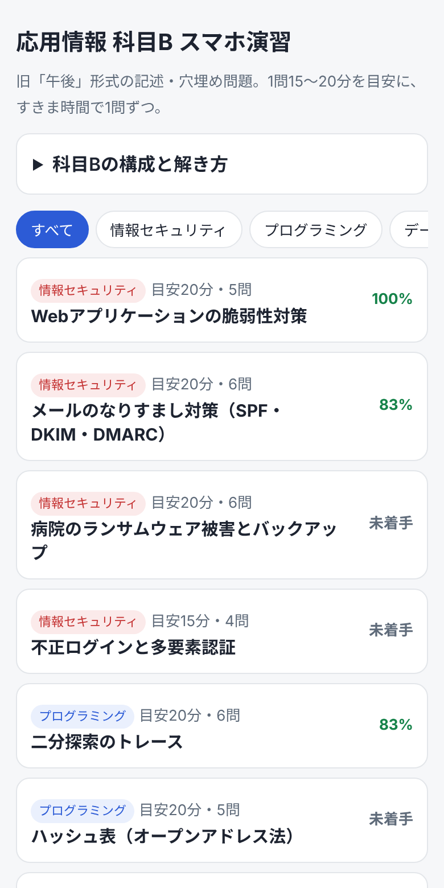
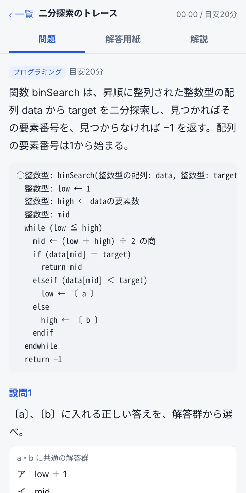
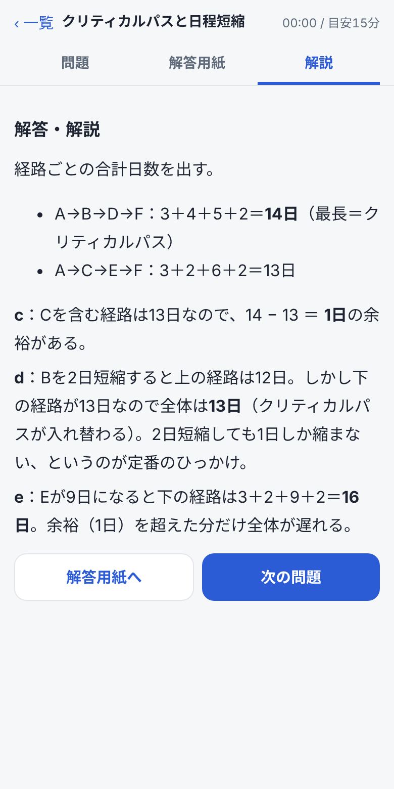
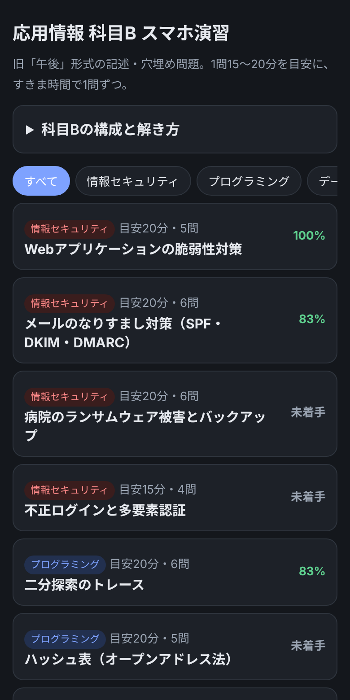

# 応用情報 科目B スマホ演習

[](https://github.com/haru-ki417/ap-b-app/actions/workflows/ci.yml)

**応用情報技術者試験の科目B（旧「午後」）を、スマホのすきま時間で。記述・穴埋め形式のオリジナル問題 17 題（解答欄 91 個）を、問題・解答用紙・解説のタブで解けるオフライン対応の Web アプリ（PWA）。**
ホーム画面に追加すればアプリとして起動し、電波のない場所でも使えます。解答と成績はスマホの中だけに保存され、外には送りません。

[**アプリを開く**](https://haru-ki417.github.io/ap-b-app/) — iPhone は Safari の共有ボタン →「ホーム画面に追加」で、アプリとして使えます。

<p>




</p>

左から、一覧（分野ごとの得点）・問題・採点後の解答用紙・解説。

> 個人の学習用に作ったアプリです。問題はすべてオリジナルで、IPA（情報処理推進機構）とは関係ありません。本番の問題は文章がもっと長いので、IPA が公開している過去の午後問題とあわせて使ってください。

## できること

| | |
|---|---|
| **問題** | 科目B と同じ「本文＋設問」の形。解答群から選ぶ・数値を答える・字数制限つきで記述する、の 3 種類の解答欄がある |
| **解答用紙** | 問題文とは別のタブ。どの問題でも同じ形（通し番号・設問・解答欄）で、本番の解答用紙のように使える |
| **字数カウント** | 記述欄に入力すると字数が出て、上限を超えると赤くなる |
| **採点** | 選択と数値は自動で採点（全角数字や「10回」のような単位つきでも正解になる）。記述は解答例とキーワードを見て ○・△・× を付ける |
| **解説** | 採点すると解説が開く。トレース表・計算の途中・記述のコツつき |
| **タイマー** | 問題を開いてからの経過時間と、目安時間を表示 |
| **成績** | 問題ごとの得点を一覧に表示。分野で絞り込める |
| **オフライン** | 一度開けば、機内モードでも起動して解ける |
| **ダークモード** | スマホの設定に合わせて切り替わる |



## 分野と問題

科目B は 150 分で、問1（情報セキュリティ）が必須、問2〜11 から 4 問を選んで解きます。必須の情報セキュリティを多めに、選ぶ人の多い分野を入れています。

| 分野 | 題数 | 問題 |
|---|---:|---|
| 情報セキュリティ（必須） | 4 | Web アプリの脆弱性（SQL インジェクション・XSS・CSRF）／メールのなりすまし対策（SPF・DKIM・DMARC）／病院のランサムウェア被害とバックアップ／不正ログインと多要素認証 |
| プログラミング | 3 | 二分探索のトレース／ハッシュ表（オープンアドレス法）／動的計画法（硬貨の最小枚数と貪欲法） |
| データベース | 3 | 診療予約表の正規化／SQL の集計と外部結合（HAVING・COUNT と NULL）／排他制御とデッドロック |
| ネットワーク | 2 | サブネット設計（VLSM）／DNS の運用（TTL・オープンリゾルバ）と NAPT |
| 組込みシステム | 2 | 腕時計型脈拍計（A/D 変換・サンプリング定理・平均消費電流）／転倒検知装置の状態遷移 |
| プロジェクトマネジメント | 2 | EVM（SV・CV・CPI・SPI・EAC）／クリティカルパスと日程短縮 |
| サービスマネジメント | 1 | SLA と稼働率（直列・並列・MTBF/MTTR）、インシデント管理と問題管理 |
| **合計** | **17** | 解答欄 91 個（選択 34・数値 40・記述 17） |

プログラムは IPA の擬似言語の書き方にそろえています。

## スマホに入れる

- **iPhone**: Safari で[アプリ](https://haru-ki417.github.io/ap-b-app/)を開き、共有ボタン（□に↑）→「ホーム画面に追加」
- **Android**: Chrome で開き、メニュー →「ホーム画面に追加」（または「アプリをインストール」）

ホーム画面のアイコンから起動すると、アドレスバーのない全画面で開きます。成績はホーム画面のアプリ・ブラウザーそれぞれに別々に保存されます。

## しくみ

ライブラリもビルドも使わない、素の HTML・CSS・JavaScript です。

| ファイル | 内容 |
|---|---|
| [`index.html`](index.html) | 画面の骨組み（一覧と、問題・解答用紙・解説のタブ） |
| [`css/style.css`](css/style.css) | スマホ向けの見た目。ライト・ダーク、ノッチの余白（safe-area）に対応 |
| [`js/problems.js`](js/problems.js) | 分野と問題のデータ（本文・解答欄・正解・解答例・キーワード・解説） |
| [`js/app.js`](js/app.js) | 一覧・解答用紙・採点・成績の保存・画面の切り替え |
| [`sw.js`](sw.js) | オフライン用のサービスワーカー |
| [`manifest.webmanifest`](manifest.webmanifest) | ホーム画面に追加したときの名前・アイコン・色 |

- **解答用紙が共通の形**: 解答欄はデータ（`items`）から作るので、問題を増やしても同じ解答用紙で解けます。
- **数値の採点**: 入力を正規化（全角→半角、マイナス記号、単位・空白の除去）してから正解の候補と比べます。
- **URL**: 問題ごとに `#p1` のような URL になるので、解きかけの問題をブックマークできます。
- **オフライン**: 初回にアプリ一式を端末に保存します。次からは保存した版をすぐ表示し、つながっていれば裏で最新版を取りに行きます（更新は次に開いたときに反映）。
- **成績の保存**: 端末の `localStorage` だけに置きます。サーバーはなく、外部への通信もしません。

## テスト

```sh
node tests/check.mjs          # 問題データと、計算・トレース問題の正解
pip install playwright && python -m playwright install chromium
python3 tests/smoke.py        # スマホ幅のブラウザーで動かす
```

| テスト | 確かめること |
|---|---|
| [`tests/check.mjs`](tests/check.mjs) | 問題データの形（id・解答欄の記号・解答群の差し込み・正解の番号・解答例が字数内か・解答例にキーワードが入っているか）／**計算・トレースの問題は、問題文どおりの処理（二分探索・ハッシュ表・動的計画法・サブネットの割当て・EVM・クリティカルパス・稼働率など）をテストの中でもう一度計算し、正解と一致するか**／オフライン用に保存するファイルがそろっているか |
| [`tests/smoke.py`](tests/smoke.py) | スマホ幅のブラウザーで、分野の絞り込み・解答群の表示・字数カウントと字数オーバー・自動採点・自己採点・解説・全角や単位つきの数値・成績の保存・通信を切っての起動 |

push のたびに GitHub Actions で両方を回します。

## 問題を追加する

[`js/problems.js`](js/problems.js) の `PROBLEMS` に 1 題足します。本文の空欄は `〔a〕`、解答群を出したい場所には `{{g:a}}` と書きます。

```js
{
  id: 's5', f: 'sec', title: '題名', min: 20,
  body: `<p>本文……〔a〕……</p><h4>設問1</h4><p>〔a〕に入れる字句を選べ。</p>{{g:a}}<p>理由を〔b〕に30字以内で述べよ。</p>`,
  items: [
    { k: 'a', l: '設問1', t: 'c', o: ['選択肢ア', '選択肢イ', '選択肢ウ'], a: 1 },              // 解答群から選ぶ（a は正解の番号）
    { k: 'b', l: '設問2', t: 'w', lim: 30, a: '解答例', kw: [['キーワード', '言い換え']] },   // 記述
    { k: 'c', l: '設問3', t: 'n', a: ['14'] },                                               // 数値・アドレス
  ],
  exp: `<p>解説</p>`
},
```

計算やトレースの問題を足したときは、[`tests/check.mjs`](tests/check.mjs) にもその計算を書いておくと、正解の誤りをテストで見つけられます。足したら `node tests/check.mjs` を通し、[`sw.js`](sw.js) の `CACHE` の番号を上げてから push してください。

## ライセンス

[MIT](LICENSE)
